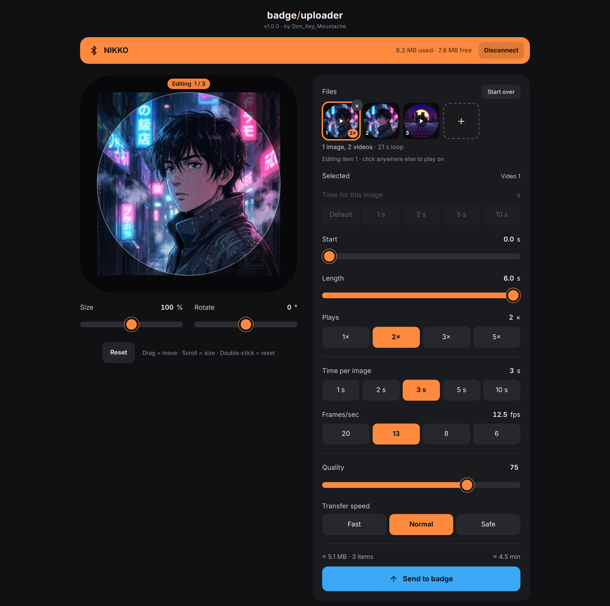
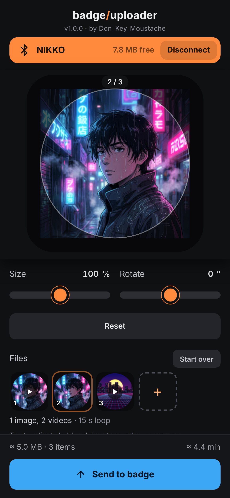

  

<h1 align="center">badge/uploader</h1>

  <b>Images, GIFs, videos and galleries for round Bluetooth e-badges – straight from the browser.</b> 
  No manufacturer app · no account · no cloud

  

  
  
  

  
  &nbsp;
  

---

## ✨ Features

| Feature | |
|---|---|
| 🎬 **Long videos** | no 3-second limit – as long as the badge's memory allows |
| 🖼️ **Mixed galleries** | images, GIFs and videos in one slideshow, always looping |
| ⏱️ **Own timing** | time per image, single images can stay longer, videos can play 2×, 3× … |
| ✂️ **Crop** | move, resize and rotate – mouse, wheel or two fingers |
| 👁️ **Live preview** | shows the real result incl. quality, frame rate and slideshow |
| 💾 **Size check** | compared with the badge's free space before sending |
| 📂 **Your files** | straight from your computer, drag & drop, several at once |
| 🔒 **Private** | runs offline in your browser – nothing is uploaded anywhere |

## 🆚 Compared with the original app

| | NN family / beamBox app | badge/uploader |
|---|---|---|
| Videos | cut to 3 s | **any length** that fits |
| Galleries | images only, fixed 3 s | **images + videos**, own time per item, repeats |
| Files | phone photo library | **any file**, drag & drop |
| Quality & frame rate | fixed | **adjustable** |
| Runs on | iPhone / Android | **Mac, Windows, Chromebook, Android** |
| Account / cloud | sign-up or guest mode | **none** |
| Source code | closed | **open source** |

## 🚀 Get started

1. **Close the manufacturer's app** – the badge accepts only one connection.
2. Open the **[app](https://menrix.github.io/BadgeUploader/)** in Chrome or Edge and click **Connect device**.
3. **Drop files** onto the page – several files become a gallery.
4. Adjust, check the preview, click **Send to badge**.

> 💡 **Too large?** Fewer frames/sec first, then lower quality. **Transfer stops?** Choose *Safe* speed.
> Bluetooth is slow (≈ 30 KB/s) – a few seconds of video can take a minute.

<b>🖥️ Which browsers work?</b>

 

Bluetooth in the browser (“Web Bluetooth”) only exists in Chromium-based browsers.

| | macOS | Windows | ChromeOS | Android | Linux | iPhone / iPad |
|---|---|---|---|---|---|---|
| Chrome / Edge / Opera | ✅ | ✅ | ✅ | ✅ | ⚠️ enable in `chrome://flags` | ❌ |
| Safari / Firefox | ❌ | ❌ | – | ❌ | ❌ | ❌ |

On iPhone/iPad every browser uses Safari's engine, so it does not work. Special browsers like **Bluefy** might – untested.
On macOS, Chrome may ask once for Bluetooth permission (System Settings → Privacy & Security → Bluetooth).

<b>📲 Install as an app</b>

 

Own icon, own window, starts offline – Bluetooth works the same.

- **Mac / Windows:** open the app in Chrome or Edge → install icon at the right end of the address bar.
- **Android:** Chrome menu ⋮ → *Install app*.

Only works from the live version (https). Alternatively download `index.html` and open it in Chrome – the whole app is this one file.

<b>🏷️ Which badges?</b>

 

- **Tested:** NIKKO Dynamic E-Badge (1.8″ round IPS, 360 × 360 px)
- **Should work:** other badges used with the **NN family** or **beamBox** app (e.g. Nikko, Nano, Niji – same round 360 × 360 display)
- **Untested:** Neo / Neo AI (also have Wi-Fi, may behave differently)

Tried another badge? Please open an issue and tell us.

<b>⚠️ Limitations</b>

 

The badge's content cannot be listed, downloaded or deleted from here (those Bluetooth commands are unknown) – use the badge's own menu.

## 🔧 How it works

The protocol was worked out by recording the original app's Bluetooth traffic: plain JSON commands plus JPEG frames in small numbered packets. Videos and galleries are frame sequences; repeated pictures are stored only once. Details in **[PROTOCOL.md](PROTOCOL.md)**.

## 📜 Version history

- **1.0.0** – first release

## 🙌 Credits & license

Made by **Don_Key_Moustache** · built with the help of [Claude Code](https://claude.com/claude-code) (Anthropic) 
[MIT license](LICENSE) – free to use, change and share, without warranty.

Independent project – not affiliated with Beambox, Shenzhen Guangsheng Artificial Intelligence Technology Co., Ltd. or the sellers of these badges. Product names and trademarks belong to their owners and are only used to describe compatibility.
